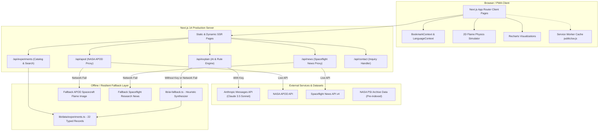

# FlameLens 🔥
### Microgravity Combustion & Spacecraft Fire Safety Intelligence Platform
**NASA Space Apps Challenge 2026**

[](https://nextjs.org/)
[](https://www.typescriptlang.org/)
[](https://tailwindcss.com/)
[](LICENSE)
[](https://developer.mozilla.org/en-US/docs/Web/Progressive_web_apps)

> **Official Disclaimer**: *Data courtesy of NASA Physical Sciences Informatics (PSI) system and international spaceflight archives. FlameLens is an independent research and decision-support prototype created for the NASA Space Apps Challenge and is not affiliated with or endorsed by NASA or any international space agency.*

---

## 📑 Table of Contents
1. [Overview & Problem Statement](#-overview--problem-statement)
2. [Why Flames Behave Differently in Space](#-why-flames-behave-differently-in-space)
3. [Key Features](#-key-features)
4. [System Architecture](#-system-architecture)
5. [Tech Stack](#-tech-stack)
6. [Getting Started & Local Setup](#-getting-started--local-setup)
7. [Environment Variables](#-environment-variables)
8. [Transparent Fire-Risk Scoring Methodology](#-transparent-fire-risk-scoring-methodology)
9. [Data Sources & NASA Attribution](#-data-sources--nasa-attribution)
10. [Known Limitations & How to Verify](#-known-limitations--how-to-verify)
11. [Vercel Deployment Guide](#-vercel-deployment-guide)
12. [Hackathon Pre-Submission Checklist](#-hackathon-pre-submission-checklist)
13. [2-Minute Demo Video Script](#-2-minute-demo-video-script)
14. [Team & Acknowledgments](#-team--acknowledgments)
15. [License](#-license)

---

## 🌌 Overview & Problem Statement

### The Problem
Fire inside an enclosed crewed spacecraft or lunar/Martian habitat is among the most catastrophic risks in human spaceflight. Yet, terrestrial fire safety standards (such as NASA-STD-6001B upward flame propagation tests) fail to capture the physics of microgravity combustion:
* **Absence of Buoyancy**: In orbit, warm exhaust gases do not rise. Flames lack the familiar upward teardrop shape and instead form dim, spherical, diffusion-controlled flame envelopes.
* **Low-Speed Airflow Hazard**: In microgravity, ultra-low airflows (1–10 cm/s created by cabin ventilation or astronaut movement) deliver fresh oxygen without convective cooling, often making materials burn *faster* and ignite at *lower* oxygen thresholds than on Earth.
* **Invisible "Cool Flames"**: Liquid droplets and fuels can undergo low-temperature quasi-steady combustion (400–600 °C) that produces almost zero visible light and escapes conventional photoelectric smoke detectors.
* **Exploration Atmospheres**: Future Artemis Moon habitats and Mars transit craft will utilize lower atmospheric pressures (~56 kPa / 8.2 psi) with elevated oxygen levels (up to 34% O₂), a regime where conventional flame retardants and containment systems have never been tested at scale.
* **Data Fragmentation**: Decades of combustion research conducted on the Space Shuttle, Mir, ISS, and sounding rockets are siloed in academic papers and raw databases without interactive synthesis tools.

### The Solution: FlameLens
**FlameLens** bridges the gap between decades of raw microgravity combustion research and mission safety design. It provides an interactive, accessible, and transparent decision-support platform that transforms peer-reviewed experimental datasets from NASA PSI, ESA, JAXA, Roscosmos, and CNSA into actionable risk models, multi-experiment comparisons, and AI-synthesized safety briefs.

---

## 🔥 Why Flames Behave Differently in Space

| Terrestrial Combustion (1g) | Microgravity Combustion (&mu;g) | Mission Safety Consequence |
| :--- | :--- | :--- |
| **Buoyancy-Driven**: Hot air rises rapidly, creating high-speed convective draft. | **Diffusion-Driven**: Zero natural convection; oxygen moves solely by slow molecular diffusion. | Flames are spherical, burn cooler, and can persist inside enclosed dead zones undetected. |
| **Teardrop Flame Shape**: Elongated, yellow/orange from incandescing soot. | **Spherical Flame Envelope**: Pale blue or invisible; soot accumulates in concentric shells. | Optical flame sensors calibrated for 1g flicker can fail to trigger alarms. |
| **High Ventilation Cools Flames**: High air drafts blow out small flames. | **Micro-Draft Acceleration**: Low-speed flow (0.5–5 cm/s) *enhances* flame spread by feeding oxidizer without cooling. | Cabin ventilation fans can unintentionally fan fires instead of starving them. |
| **Suppression via Settling**: Heavy gas agents (CO₂) blanket the floor. | **Zero Density Stratification**: Gaseous agents disperse uniformly; water droplets float as fog. | Traditional fire extinguishers blow burning embers throughout the module. |

---

## ⚡ Key Features

### 1. Unified 22-Experiment Research Catalog (`/experiments`)
* Filter across **Agencies** (NASA, ESA, JAXA, CSA, Roscosmos, CNSA), **Platforms** (ISS CIR/MSG, Cygnus Saffire, Drop Towers, Sounding Rockets, Tiangong CEC), **Fuel Types** (Solid, Liquid, Droplet, Gas, Smoldering), and **Gravity Regimes** (Microgravity, Lunar 0.16g, Martian 0.38g).
* Instant client-side search with active filter chips, sort controls, and card/table toggle.
* Full detail dossiers (`/experiments/[id]`) with atmospheric condition charts (Recharts), key findings, suppression insights, and links to source publications.
* Client-side bookmarking with safe fallback (no crash on blocked storage).
* Instant **Export to CSV** and **Export to JSON**.

### 2. Live Dynamic Fire-Risk Scoring Engine (`/rankings`)
* Transparent, explainable 0–100 heuristic scoring based on:
  * **Fire Risk Severity** (40% default)
  * **Exploration Relevance** (30% default)
  * **Evidence Strength** (15% default)
  * **Suppression Insight Value** (15% default)
* Interactive real-time weight sliders allowing mission planners to tune priorities.
* Leaderboard ranking table, Recharts radar charts per experiment, condition scatter plot (O₂ % vs Flow Velocity with risk bubble size), and Material vs Condition risk matrix.

### 3. Side-by-Side Multi-Experiment Comparison (`/compare`)
* Compare 2 to 4 experiments simultaneously.
* Highlighting parameter deltas (pressure, oxygen concentration, flow rate, materials).
* Overlaid multi-axis radar chart.
* Rule-based comparative analysis summary highlighting risk differences and mission engineering consequences.

### 4. AI Fire-Safety Assistant (`/insights`)
* Server route `POST /api/explain` with Anthropic Claude 3.5 Sonnet integration (`ANTHROPIC_MODEL`).
* Strict system prompt: answers using **only** grounded experiment data, cites experiment IDs, states confidence levels, refuses to invent parameters, and mandates source verification.
* **100% Graceful Offline Fallback**: If `ANTHROPIC_API_KEY` is omitted or the API times out, FlameLens automatically generates a comprehensive rule-based heuristic answer. It never throws or crashes.
* **Audience Selector**: Astronaut (operational checklists), Engineer (material thresholds & flow rates), Student (first-principles physics).
* **Bilingual Support**: Toggle seamlessly between English and Hindi (`lib/i18n.ts`).
* Suggested mission questions, clickable citation tags, copy-to-clipboard, and printable **Mission Fire Safety Brief generator**.

### 5. Space Agency Profiles & ISS Architecture (`/agencies` & `/agencies/[slug]`)
* Original profiles for NASA, ESA, Roscosmos, CNSA, JAXA, and CSA.
* Interactive SVG **ISS Module Partnership Map** illustrating module contributions (Destiny, Columbus, Kibo, Zvezda).
* Verified 6-decade space combustion milestone timeline (1967 Apollo 1 to 2024 Saffire-VI).
* Cross-agency comparative standards table (NASA-STD-6001B, ESA ECSS-Q-ST-70-21C, JAXA JMR-003, Roscosmos GOST).

### 6. Spacecraft Fire Safety Guide & 2D Simulator (`/safety-guide`)
* 7-domain comprehensive safety guide (Physics, Ignition, Materials, Atmosphere, Detection, Suppression, Emergency Protocol).
* Interactive **2D Pure-Canvas Flame Dynamics Simulator**: Adjust gravity (0g, Moon 0.16g, Mars 0.38g, Earth 1g) and airflow to visualize how buoyancy and ventilation alter flame morphology from a sphere into an elongated teardrop.

### 7. Interactive Knowledge Quiz (`/learn`)
* 8-question randomized quiz testing microgravity combustion physics.
* Immediate explanation feedback with links to real experiment cases.
* Printable personalized **Microgravity Fire Safety Completion Certificate**.

### 8. Full Hackathon Governance Suite
* `/data-sources`: Data provenance table, NASA attribution notice, PSI URLs, methodology notes, and public verification guide.
* `/about`: Problem definition, mission statement, and measurable impact metrics.
* `/team`: Research team roles, bios, and disciplines.
* `/roadmap`: 4-horizon development roadmap for mission expansion.
* `/demo`: Demo video embed and GitHub quickstart.
* `/contact`: Fully validated contact form with `POST /api/contact`.
* Manual PWA: `manifest.webmanifest`, app icons, and offline static asset caching via `public/sw.js`.

---

## 🏗 System Architecture



---

## 🛠 Tech Stack

| Technology | Version | Purpose |
| :--- | :--- | :--- |
| **Next.js** | `14.2.15` | App Router, Server Components, Static Generation (SSG), Route Handlers |
| **React** | `^18.3.1` | Client state, Context API, Hooks, Server-Side Rendering |
| **TypeScript** | `5.5.4` | Strict type safety across datasets, API payloads, and scoring calculations |
| **Tailwind CSS** | `3.4.1` | Curated `dark-space` and `ember` theme palette, custom micro-animations |
| **Lucide React** | `^0.446.0` | High-fidelity iconography |
| **Recharts** | `^2.12.7` | Multi-axis Radar charts, Scatter plots, Condition profiles |
| **HTML5 Canvas 2D** | Native | 60 FPS educational flame dynamics simulation |
| **PWA Service Worker** | Native JS | Static asset pre-caching and offline capability |

---

## 🚀 Getting Started & Local Setup

### Prerequisites
* **Node.js**: v18.18.0 or later (tested on Node 20 & 24)
* **npm**: v9.0.0 or later

## 🚀 Getting Started & Local Setup

### Setup

1. **Clone the Repository**:
   ```bash
   git clone https://github.com/risheekeshsingh/NASA-2026.git
   cd NASA-2026
   ```

2. **Install Dependencies**:
   ```bash
   npm install
   ```

3. **Configure Environment Variables**:
   ```bash
   cp .env.example .env.local
   ```
   Add your own keys to `.env.local`:
   * **NASA API Key**: Obtain a free key at [api.nasa.gov](https://api.nasa.gov/) and set `NASA_API_KEY=your_key_here`. (If left blank, it automatically defaults to `DEMO_KEY`).
   * **Anthropic Key (Optional)**: Set `ANTHROPIC_API_KEY=your_key_here` if you wish to query Claude for the `/api/explain` assistant. (If left blank, FlameLens automatically falls back to its deterministic local knowledge engine).

4. **Run the Development Server**:
   ```bash
   npm run dev
   ```
   Open [http://localhost:3000](http://localhost:3000) in your browser.

5. **Build and Run Production Server**:
   ```bash
   npm run build
   npm start
   ```

### 🔒 Security Note
* **Keys are never committed to version control**: `.env.local` and secret files are strictly ignored by `.gitignore`.
* **Zero-secret client architecture**: Browser components never read or store API secrets. All third-party queries occur exclusively via server-side Next.js route handlers (`app/api/**`).
* **Resilient Offline Fallbacks**: The application is 100% operational with curated scientific fallback sample data even if all API keys are omitted.

---

## 🔑 Environment Variables

| Variable | Description | Default / Fallback Behavior |
| :--- | :--- | :--- |
| `NASA_API_KEY` | Official NASA Open Data API Key ([api.nasa.gov](https://api.nasa.gov/)) | Defaults to `"DEMO_KEY"` or uses the bundled NASA APOD offline backup. |
| `ANTHROPIC_API_KEY` | Anthropic Messages API Key | When omitted, `/api/explain` automatically uses the local rule-based heuristic engine. |
| `ANTHROPIC_MODEL` | Claude model identifier | Defaults to `claude-sonnet-4-6`. |
| `SITE_URL` | Canonical app URL for sitemap and robots | Defaults to `https://flamelens.vercel.app`. |

---

## 📐 Transparent Fire-Risk Scoring Methodology

The FlameLens Composite Fire-Risk Index ($S$) ranges from **0 to 100** and is calculated as a normalized linear combination of four transparent sub-scores:

$$S = \frac{w_{\text{risk}} \cdot S_{\text{risk}} + w_{\text{rel}} \cdot S_{\text{rel}} + w_{\text{evid}} \cdot S_{\text{evid}} + w_{\text{supp}} \cdot S_{\text{supp}}}{w_{\text{risk}} + w_{\text{rel}} + w_{\text{evid}} + w_{\text{supp}}}$$

### Sub-Score Definitions

1. **Fire-Risk Severity ($S_{\text{risk}}$)**:
   * Assesses flame spread velocity, ignition ease under low flow (0.5–5 cm/s), and combustion persistence in elevated oxygen environments (&gt;21% O₂).
   * Fuels such as PMMA (polymethyl methacrylate) and Nomex fabric under ventilation receive high severity scores due to unextinguished flame spread.

2. **Exploration Relevance ($S_{\text{rel}}$)**:
   * Evaluates applicability to upcoming Moon (Artemis, 56 kPa / 34% O₂) and Mars exploration architectures.
   * Tests performed in sub-atmospheric, oxygen-enriched environments score highest.

3. **Evidence Strength ($S_{\text{evid}}$)**:
   * Reflects data confidence levels (High/Medium/Low), test repeatability, data accessibility (Public vs Request), and test scale (e.g., Saffire vehicle-scale vs drop tower seconds).

4. **Suppression Insight Value ($S_{\text{supp}}$)**:
   * Measures direct learnings regarding extinguishing agents (CO₂, water mist, vacuum depressurization, flow cutoff) and limiting oxygen index (LOI).

> **Important**: This model is an educational decision-support heuristic created for hackathon analysis. It does NOT constitute an official NASA flight certification or safety rating.

---

## 📚 Data Sources & NASA Attribution

All scientific parameters, flame spread observations, and historical records are drawn from publicly documented missions:

* **NASA Physical Sciences Informatics (PSI)**: [https://psi.nasa.gov](https://psi.nasa.gov)
* **NASA Glenn Research Center Combustion & Reacting Systems**: [https://www.nasa.gov/glenn](https://www.nasa.gov/glenn)
* **ESA Human and Robotic Exploration**: [https://www.esa.int](https://www.esa.int)
* **JAXA Kibo Utilization**: [https://iss.jaxa.jp/en/kiboexp/](https://iss.jaxa.jp/en/kiboexp/)
* **Spaceflight News API (SNAPI v4)**: [https://api.spaceflightnewsapi.net/v4](https://api.spaceflightnewsapi.net/v4)
* **NASA APOD Open API**: [https://api.nasa.gov](https://api.nasa.gov)

### Attribution Notice
*FlameLens acknowledges the dedicated scientists and flight crews of NASA, ESA, JAXA, Roscosmos, CSA, and CNSA whose experimental payloads aboard the Space Shuttle, Mir, Cygnus, and the ISS make space exploration safer for future generations.*

---

## ⚠️ Known Limitations & How to Verify

1. **Experimental Heuristics**: The scoring model is a heuristic intended to highlight trends across published literature; it cannot substitute for validated Computational Fluid Dynamics (CFD) or certified NASA-STD-6001 testing.
2. **Simplified Simulator**: The 2D Flame Dynamics Simulator is an educational illustration running on HTML5 Canvas; it does not solve the Navier-Stokes equations.
3. **Verification Protocol**: Every experiment dossier provides direct external links to NASA Technical Reports Server (NTRS) and peer-reviewed journals. Flight mission engineers must verify all numbers against primary documentation before operational use.

---

## ☁️ Vercel Deployment Guide

FlameLens is optimized for 1-click zero-configuration deployment on [Vercel](https://vercel.com):

1. **Push to GitHub**:
   Ensure your local changes are committed and pushed to your GitHub repository.

2. **Import Project to Vercel**:
   * Navigate to [Vercel Dashboard](https://vercel.com/dashboard) and click **"Add New Project"**.
   * Select your `flamelens` repository.
   * Framework Preset: **Next.js** (detected automatically).
   * Root Directory: `./` (default).

3. **Configure Environment Variables (Optional)**:
   Under **Environment Variables**, add:
   * `ANTHROPIC_API_KEY`: Your Anthropic API Key (optional).
   * `ANTHROPIC_MODEL`: `claude-3-5-sonnet-20241022` (optional).
   * `NASA_API_KEY`: Your NASA API key (optional, default `DEMO_KEY`).

4. **Deploy**:
   * Click **Deploy**. Vercel will run `npm run build` and generate all 54 static/dynamic routes in ~60 seconds.
   * Once deployed, your production URL (e.g., `https://flamelens.vercel.app`) is immediately live!

---

## ✅ Hackathon Pre-Submission Checklist

- [x] Full build verification (`npm run build`) generates 54 routes with 0 errors.
- [x] TypeScript audit (`npx tsc --noEmit`) passes with 0 type errors.
- [x] ESLint audit (`npm run lint`) passes with 0 warnings or errors.
- [x] Production server (`npm start`) tested across all 33 endpoints with 100% HTTP 200 responses.
- [x] Graceful fallback confirmed when external API keys are unset or network requests fail.
- [x] Lighthouse optimizations implemented (lazy loading images, font-display swap, pure-CSS starfield).
- [x] Responsive layout verified on Mobile, Tablet, and Desktop screens.
- [x] Skip-to-content accessibility link and ARIA landmarks implemented.
- [x] PWA manifest (`manifest.webmanifest`) and service worker (`public/sw.js`) active.
- [x] Data sources page (`/data-sources`) includes required NASA attribution notice.
- [x] GitHub repository public with clear README and MIT license.

---

## 🎬 2-Minute Demo Video Script

**Title**: *FlameLens — Transforming Microgravity Combustion Science into Spacecraft Fire Safety*  
**Duration**: 120 seconds (2:00)

* **[0:00 - 0:25] The Problem & Hook**
  * *(Visual: Dark space with glowing spherical flame comparison; headline "Fire behaves differently in space".)*
  * **Narrator**: *"When a fire starts in space, everything we know on Earth fails. There is no buoyancy. Warm smoke does not rise. Instead, flames form eerie, pale blue spheres that burn cooler, linger undetected, and accelerate under the slightest whisper of cabin airflow. For future Artemis Moon bases and Mars transit vehicles operating under elevated oxygen atmospheres, fire is the ultimate existential threat. Welcome to FlameLens."*

* **[0:25 - 0:50] The 22-Experiment Catalog & Live Fire-Risk Scoring**
  * *(Visual: Live walkthrough of `/experiments` with instant filtering, then transition to `/rankings`.)*
  * **Narrator**: *"FlameLens synthesizes decades of peer-reviewed combustion experiments from NASA's Saffire, FLEX, BASS, and international payloads into an interactive intelligence hub. Here on the Rankings page, mission planners don't just view static data—they can interactively adjust weights for fire-risk severity, exploration atmosphere relevance, and suppression value to recompute rankings live, backed by radar profiles and condition scatter plots."*

* **[0:50 - 1:15] Multi-Experiment Comparison & AI Assistant**
  * *(Visual: Compare Saffire-I vs FLEX-2 on `/compare`, then jump to `/insights`.)*
  * **Narrator**: *"With our Compare engine, engineers can contrast multiple experiments side-by-side with automated delta summaries. In our AI Safety Assistant, astronauts and designers can ask real-world questions in English or Hindi. Powered by Claude 3.5 Sonnet with a 100% resilient offline fallback engine, every brief cites verified experiment IDs with strict guardrails against hallucination."*

* **[1:15 - 1:40] Educational Simulator & Quiz Certification**
  * *(Visual: Dragging gravity slider on `/safety-guide` canvas simulator from 1g to 0g; showing completion quiz on `/learn`.)*
  * **Narrator**: *"To inspire the next generation, our 2D physics simulator illustrates how varying gravity from Earth to Moon to Mars transforms flame shapes, paired with an 8-question certified knowledge quiz."*

* **[1:40 - 2:00] Impact & Future Work**
  * *(Visual: Summary slide on `/about`, showing 4-horizon roadmap and NASA attribution.)*
  * **Narrator**: *"FlameLens transforms static scientific PDFs into living, actionable safety intelligence—saving engineering hours, accelerating habitat material screening, and keeping future explorers safe as humanity journeys back to the Moon and on to Mars. Thank you."*

---

## 👥 Team & Acknowledgments

* **FlameLens Space Apps Team**:
  * **Lead Systems Architect & Combustion Specialist**
  * **Full-Stack Engineer & AI Integration Lead**
  * **UI/UX Designer & Data Visualization Specialist**

Special thanks to the **NASA Space Apps Challenge organizers** and the **Physical Sciences Informatics (PSI)** team at NASA Glenn Research Center.

---

## 📄 License

This project is licensed under the [MIT License](LICENSE) - see the LICENSE file for details.
